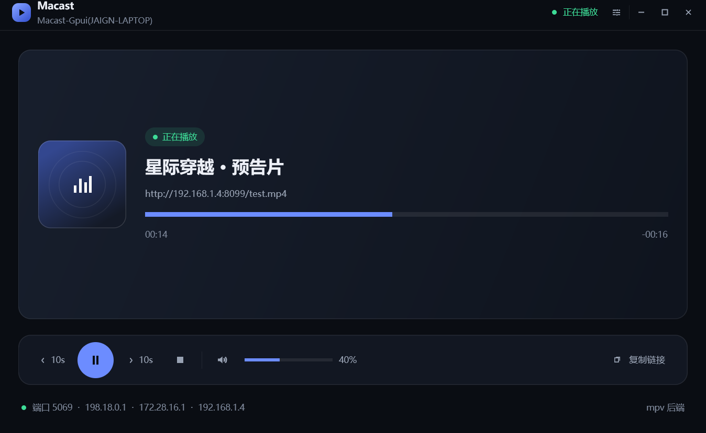

# Macast-Gpui

[](https://github.com/tiramission/macast-gpui/actions/workflows/ci.yml)

用 **Rust + gpui** 复刻 [Macast](https://github.com/xfangfang/Macast)：一个跨平台的 **DLNA 媒体接收端（投屏接收器）**。手机视频 App 的"投屏"列表里会出现你的电脑，点一下即可把视频/图片/音乐推过来，由 mpv 播放。



```
macast-gpui/
├── GUIDE.md               # 复刻实施指南（架构解析 / 协议细节 / 分阶段路线 / 测试方法）
├── crates/
│   ├── macast-core/       # DLNA/UPnP 协议核心（无 UI，可独立测试）
│   └── macast-app/        # gpui 桌面界面
```

## 功能

- **SSDP 设备发现**：多网卡组播、M-SEARCH 应答（MX 抖动 + 同子网选路）、周期性 `ssdp:alive` / 退出 `ssdp:byebye`
- **完整 MediaRenderer 设备**：`/description.xml` + 三个服务（AVTransport / RenderingControl / ConnectionManager）的 SCPD 描述
- **SOAP 控制**：`SetAVTransportURI`（含 DIDL-Lite 元数据标题解析）、`Play/Pause/Stop/Seek`、音量/静音、`GetProtocolInfo` 等全部查询动作
- **GENA 事件订阅**：SUBSCRIBE/UNSUBSCRIBE/续期，初始全量推送 + `LastChange` 增量推送
- **mpv 播放后端**：外部 mpv 进程 + JSON IPC（与 Macast 同方案），属性观察实时回传进度/时长/播放状态
- **gpui 界面（影音控制台）**：自绘标题栏、Now Playing 大卡片、悬浮控制栏、侧滑设置面板、矢量图标（canvas 绘制，无图片资源）
- **主题**：亮色 / 暗色 / **自动（默认，跟随系统）**，设置面板切换即时生效
- **后端状态透明**：设置里区分「当前运行」与「启动后端」；mpv 缺失时明确显示回退到 null 及原因
- **设置面板**：查看设备名/端口/UDN、切换 mpv/null 后端、一键打开 `config.json`、Windows 开机自启开关
- **拖拽播放**：把本地视频/音频拖进窗口即可直接播放（自动转 `file://` URI）
- **系统托盘（Windows）**：关闭窗口 = 隐藏到托盘；托盘左键/菜单恢复窗口，菜单可退出
- **应用图标**：exe / 窗口 / 任务栏统一图标（资源 ID 1，gpui 直接加载）
- **按需显示 mpv 窗口**：启动后不弹空播放器窗口；开始投屏才出现，Stop 后自动关闭
- **投屏默认全屏**：每次投屏开始时 mpv 自动全屏（`mpv_fullscreen`，设置面板可开关；播放中 Esc 可临时退出）
- **GPU 渲染 / 快速启动**：gpui 走 Direct3D 11 硬件加速，release 约 0.25 秒显示主窗口
- **可插拔播放器**：`Player` trait；无 mpv 环境可用 `null` 后端联调协议

## 快速开始

### 依赖

- Rust stable（建议 ≥ 1.90，开发用的是 1.96）
- **mpv**（Windows：装 mpv 并确保 `mpv.exe` 在 PATH；或在配置里写绝对路径）
  - 没有 mpv 也能跑：把配置里的 `player` 改为 `"null"`，用于联调 DLNA 协议

### 运行

```bash
cargo run -p macast-app
```

首次运行会在配置目录生成 `config.json`（含设备 UDN，**请保留**，删除后手机会当成新设备）：

- Windows: `%APPDATA%\macast-gpui\config.json`
- macOS: `~/Library/Application Support/macast-gpui/config.json`
- Linux: `~/.config/macast-gpui/config.json`

```json
{
  "udn": "xxxxxxxx-xxxx-xxxx-xxxx-xxxxxxxxxxxx",
  "friendly_name": "Macast-Gpui(你的电脑名)",
  "port": 5069,
  "player": "mpv",
  "mpv_path": null,
  "mpv_fullscreen": true,
  "theme": "auto",
  "ssdp_notify_secs": 30,
  "max_age": 1800
}
```

### 测试投屏

1. 手机和电脑连**同一局域网**（同一网段，别用访客网络）
2. 打开手机视频 App 的"投屏 / TV / Cast"，列表里选择 `Macast-Gpui(...)`
3. 桌面端控制端：VLC（视图 → 播放列表 → Universal Plug'n'Play）或 Kodi
4. 手动测 SOAP：

```bash
curl -i -X POST http://127.0.0.1:5069/AVTransport/action \
  -H 'SOAPACTION: "urn:schemas-upnp-org:service:AVTransport:1#GetTransportInfo"' \
  --data '<s:Envelope xmlns:s="http://schemas.xmlsoap.org/soap/envelope/"><s:Body><u:GetTransportInfo xmlns:u="urn:schemas-upnp-org:service:AVTransport:1"><InstanceID>0</InstanceID></u:GetTransportInfo></s:Body></s:Envelope>'
```

浏览器打开 `http://127.0.0.1:5069/` 可以看到实时状态 JSON。

更多测试手段、打包分发、常见坑排查见 **[GUIDE.md](GUIDE.md)**。

## 构建

```bash
cargo build --release -p macast-app   # 产物 target/release/macast-app.exe
```

> **Windows 上编译 gpui 如果遇到 rustc 崩溃**（`STATUS_STACK_BUFFER_OVERRUN`，exit code `0xc0000409`）：
> 这是 gpui 这个超大 crate 在本机环境下的已知问题，与代码无关。两种绕过方式（任选）：
>
> ```bash
> cargo build -p macast-app -j 2                              # 限制并行度
> CARGO_PROFILE_DEV_DEBUG=false cargo build -p macast-app    # 关调试信息，减轻 codegen 压力
> ```
>
> 先跑 `cargo check -p macast-app -j 2` 验证代码也无妨（只做元数据检查，最稳）。

### 日志

- **release / 双击 exe**：Windows GUI 子系统，不弹终端；日志写到 `%APPDATA%\macast-gpui\logs\macast-gpui.log`（超过 5 MiB 会在下次启动时清空）
- **debug / `cargo run`**：保留控制台，日志直接打在终端

> **release 构建报 `Failed to find fxc.exe`**：gpui 用 Windows SDK 的 fxc 编译着色器，只认 PATH 和某个固定版本号。把 `GPUI_FXC_PATH` 指向 `C:\Program Files (x86)\Windows Kits\10\bin\<版本>\x64\fxc.exe` 即可；`scripts\package.ps1` 会自动探测。

### 打包（Windows）

```powershell
powershell -ExecutionPolicy Bypass -File scripts\package.ps1
# 产物：dist\macast-gpui-0.1.0-windows-x64.zip（exe + 文档 + 首次运行说明）
```

## 测试

```bash
cargo test -p macast-core          # 协议/工具函数单元测试
cargo fmt --all -- --check         # CI 同款格式检查
python scripts/tray_smoke_test.py --quit   # Windows 托盘：关闭隐藏/点击恢复/菜单退出（先启动应用）
```

CI（GitHub Actions，Windows）会在每次推送时跑格式检查、核心测试和应用编译。

## 架构

```
手机(DLNA Control Point)
  │ SSDP M-SEARCH / NOTIFY
  ▼
macast-core（tokio + axum + socket2）
  ├─ ssdp.rs        组播发现与通告
  ├─ http.rs        /description.xml · /dlna/*.xml · POST /{Service}/action · SUBSCRIBE /{Service}/event
  ├─ services/      AVTransport / RenderingControl / ConnectionManager 动作处理
  ├─ state.rs       UPnP 状态变量 + UI 快照（watch 通道）
  ├─ eventing.rs    GENA 订阅表 + LastChange NOTIFY
  └─ player/        Player trait ← mpv.rs（JSON IPC）/ null.rs
        │
macast-app（gpui）── watch::Receiver<PlaybackSnapshot> ──► RootView 重绘
```

与 Macast 原版（Python）的模块对应关系见 GUIDE.md §4.1。

## 已知边界 / Roadmap

- [x] 点击进度条跳转（Seek）+ 快进/快退 10 秒
- [x] 设置面板（查看配置、切换播放后端、打开 `config.json`；文本编辑仍走配置文件）
- [x] 拖拽本地媒体文件到窗口直接播放
- [x] Windows 开机自启（HKCU Run 键，设置面板里开关）
- [x] 托盘图标 + 关闭窗口隐藏到托盘（Windows；菜单可恢复/退出）
- [ ] macOS/Linux 托盘（同一套 `tray-icon` API，需各自把关闭行为接上）
- [ ] 应用内文本输入（gpui 0.2.2 无 Input 元素 / IME 支持，需自行实现）
- [ ] 安装包（见 GUIDE §7）
- [ ] AirPlay / Chromecast 协议（协议完全不同，工作量大）
- [ ] 视频嵌入 gpui 窗口（mpv render API → wgpu 纹理）

## 致谢与许可

- 协议行为参照 [Macast](https://github.com/xfangfang/Macast)（MIT）实现；`macast-core/assets/` 下的 SCPD 与 SinkProtocolInfo 来自该项目（见 `assets/NOTICE.txt`）
- 本项目代码以 [MIT](LICENSE) 许可发布
