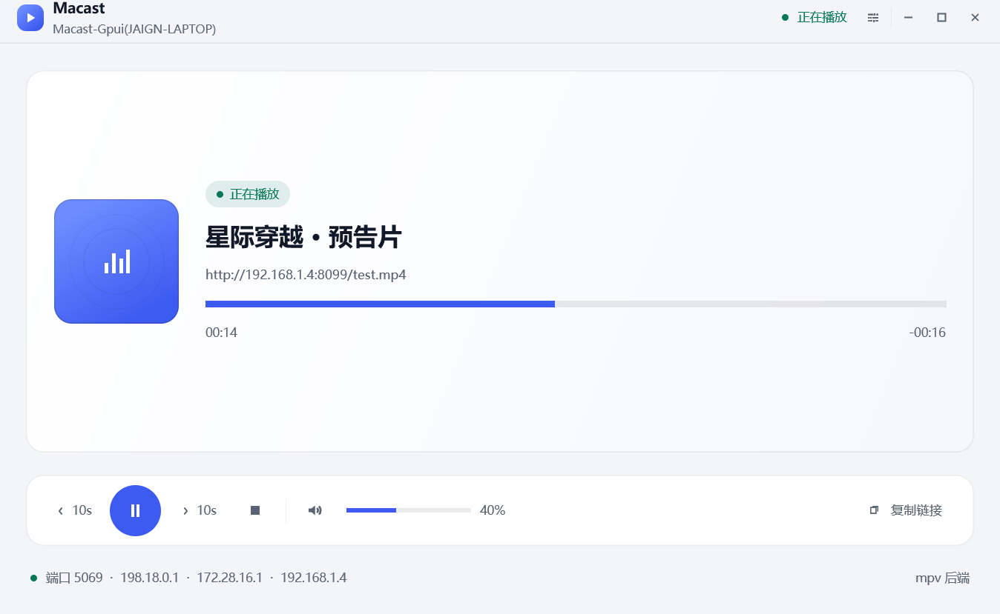

# Macast-Gpui

[](https://github.com/tiramission/macast-gpui/actions/workflows/ci.yml)

用 **Rust + gpui** 复刻 [Macast](https://github.com/xfangfang/Macast)：一个跨平台的 **DLNA 媒体接收端（投屏接收器）**。手机视频 App 的"投屏"列表里会出现你的电脑，点一下即可把视频/图片/音乐推过来：默认用**内置播放器把画面直接画在应用窗口里**，也可以切换成外部 mpv 窗口播放。

| 暗色主题 | 亮色主题（跟随系统） |
|:---:|:---:|
|  |  |

```
macast-gpui/
├── GUIDE.md               # 复刻实施指南（架构解析 / 协议细节 / 分阶段路线 / 测试方法）
├── crates/
│   ├── macast-core/       # DLNA/UPnP 协议核心（无 UI，可独立测试）
│   └── macast-app/        # gpui 桌面界面
```

## 功能

- **SSDP 设备发现**：多网卡组播、M-SEARCH 应答（MX 抖动 + 同子网选路）、周期性 `ssdp:alive` / 退出 `ssdp:byebye`
- **完整 MediaRenderer 设备**：`/description.xml` + 三个服务（AVTransport / RenderingControl / ConnectionManager）的 SCPD 描述
- **SOAP 控制**：`SetAVTransportURI`（含 DIDL-Lite 元数据标题解析）、`Play/Pause/Stop/Seek`、音量/静音、`GetProtocolInfo` 等全部查询动作
- **GENA 事件订阅**：SUBSCRIBE/UNSUBSCRIBE/续期，初始全量推送 + `LastChange` 增量推送
- **两种窗口内播放后端**（`Player` trait，可插拔；都不弹外部窗口，画面直接画在 Now Playing 卡片里）：
  - **alhazen（默认）**：纯进程内解码（alhazen-core），画面走 gpui `video_view()`；Windows 走 Media Foundation DXVA 硬件解码，**零外部依赖**
  - **mpv**：进程内加载 `libmpv-2.dll`（libmpv + JSON 控制/事件），画面用 mpv 的 SW render API 渲成 BGRA 帧再交给 gpui `paint_image`；**不需要 `mpv.exe`**
- **图片投屏**：手机相册/图库投照片（DLNA `object.item.imageItem.photo`）也直接显示在窗口内。图片由 UI 层自己下载 + 解码 + 绘制，**不经过任一播放后端**（alhazen / mpv 都不解码图片）；支持 `http(s)://` 与本地 `file://`（拖拽图片文件同理），Stop 后清除画面
- **gpui 界面（影音控制台）**：自绘标题栏、Now Playing 大卡片、悬浮控制栏、侧滑设置面板、矢量图标（canvas 绘制，无图片资源）
- **主题**：亮色 / 暗色 / **自动（默认，跟随系统）**，设置面板切换即时生效
- **设置面板**：显示「当前运行」的后端；切换 alhazen / mpv（重启后生效），可一键打开 `config.json`、开关 Windows 开机自启、开关系统托盘
- **拖拽播放**：把本地视频/音频拖进窗口即可直接播放（自动转 `file://` URI）
- **系统托盘（Windows）**：关闭窗口 = 隐藏到托盘；托盘左键/菜单恢复窗口，菜单可退出；`tray_enabled: false` 则不常驻托盘、关窗直接退出
- **应用图标**：exe / 窗口 / 任务栏统一图标（资源 ID 1，gpui 直接加载）
- **按需显示播放器**：启动后不弹空播放窗口；投屏开始才出现，Stop / 播完自动收起
- **每次投屏全屏**（`mpv_fullscreen`，默认开）：alhazen 让应用窗口进入全屏、视频铺满；mpv 让播放器窗口全屏。**Esc 只退出全屏，播放和程序都不受影响**
- **GPU 渲染 / 快速启动**：gpui 走 Direct3D 11 硬件加速，release 约 0.25 秒显示主窗口

## 快速开始

### 依赖

- Rust stable（建议 ≥ 1.90，开发用的是 1.96）
- **默认不需要任何外部播放器**：alhazen 后端是进程内解码（Windows 用系统自带的 Media Foundation，H.264/AAC 开箱可用，HEVC 需系统「HEVC 视频扩展」）
- **可选 mpv 后端**：只用 alhazen 时不需要。想用 mpv 引擎时提供 `libmpv-2.dll`（放 exe 同目录、加进 `PATH`，或用 `player.libmpv_path` 指定）；它是 mpv 的库版本，**不需要 `mpv.exe`**

### 运行

```bash
cargo run -p macast-app
```

首次运行会在配置目录生成 `config.json`（含设备 UDN，**请保留**，删除后手机会当成新设备）：

- Windows: `%APPDATA%\macast-gpui\config.json`
- macOS: `~/Library/Application Support/macast-gpui/config.json`
- Linux: `~/.config/macast-gpui/config.json`

```json
{
  "device": {
    "udn": "xxxxxxxx-xxxx-xxxx-xxxx-xxxxxxxxxxxx",
    "friendly_name": "Macast-Gpui(你的电脑名)",
    "port": 5069
  },
  "player": {
    "kind": "alhazen",            // "alhazen"（默认，纯 Rust 进程内解码）/ "mpv"（需要 libmpv-2.dll）
    "fullscreen_on_cast": true,   // 每次投屏全屏，Esc 退出全屏（不影响播放）
    "libmpv_path": null           // libmpv-2.dll 路径；null = 自动探测（exe 同目录 / PATH）
  },
  "ui": {
    "theme": "auto",              // "auto" / "light" / "dark"
    "tray_enabled": true          // false：不常驻托盘，关窗即退出
  },
  "network": {
    "ssdp_notify_secs": 30,
    "max_age": 1800
  }
}
```

> 配置按 `device` / `player` / `ui` / `network` 分组，每组都有默认值，文件里只需要写要改的项。
> 两种后端都是**窗口内渲染**：alhazen 零依赖，mpv 需要 `libmpv-2.dll`（不再有 `render_mode` / 外部 `mpv.exe` 这一说）。

### 测试投屏

1. 手机和电脑连**同一局域网**（同一网段，别用访客网络）
2. 打开手机视频 App 的"投屏 / TV / Cast"，列表里选择 `Macast-Gpui(...)`
3. 桌面端控制端：VLC（视图 → 播放列表 → Universal Plug'n'Play）或 Kodi
4. 手动测 SOAP：

```bash
curl -i -X POST http://127.0.0.1:5069/AVTransport/action \
  -H 'SOAPACTION: "urn:schemas-upnp-org:service:AVTransport:1#GetTransportInfo"' \
  --data '<s:Envelope xmlns:s="http://schemas.xmlsoap.org/soap/envelope/"><s:Body><u:GetTransportInfo xmlns:u="urn:schemas-upnp-org:service:AVTransport:1"><InstanceID>0</InstanceID></u:GetTransportInfo></s:Body></s:Envelope>'
```

浏览器打开 `http://127.0.0.1:5069/` 可以看到实时状态 JSON。

更多测试手段、打包分发、常见坑排查见 **[GUIDE.md](GUIDE.md)**。

## 构建

```bash
cargo build --release -p macast-app   # 产物 target/release/macast-gpui.exe
```

> **Windows 上编译 gpui 如果遇到 rustc 崩溃**（`STATUS_STACK_BUFFER_OVERRUN`，exit code `0xc0000409`）：
> 这是 gpui 这个超大 crate 在本机环境下的已知问题，与代码无关。两种绕过方式（任选）：
>
> ```bash
> cargo build -p macast-app -j 2                              # 限制并行度
> CARGO_PROFILE_DEV_DEBUG=false cargo build -p macast-app    # 关调试信息，减轻 codegen 压力
> ```
>
> 先跑 `cargo check -p macast-app -j 2` 验证代码也无妨（只做元数据检查，最稳）。

### 日志

- **release / 双击 exe**：Windows GUI 子系统，不弹终端；日志写到 `%APPDATA%\macast-gpui\logs\macast-gpui.log`（超过 5 MiB 会在下次启动时清空）
- **debug / `cargo run`**：保留控制台，日志直接打在终端

> **release 构建报 `Failed to find fxc.exe`**：gpui 用 Windows SDK 的 fxc 编译着色器，只认 PATH 和某个固定版本号。把 `GPUI_FXC_PATH` 指向 `C:\Program Files (x86)\Windows Kits\10\bin\<版本>\x64\fxc.exe` 即可；`scripts\package.ps1` 会自动探测。

### 打包（Windows）

```powershell
powershell -ExecutionPolicy Bypass -File scripts\package.ps1
# 产物：dist\macast-gpui-0.1.0-windows-x64.zip（exe + 文档 + 首次运行说明）
```

免安装的 zip 之外，还可以用 [cargo-packager](https://github.com/crabnebula-dev/cargo-packager) 打出 **NSIS 安装包**（含桌面/开始菜单快捷方式、卸载项、双语界面）：

```powershell
powershell -ExecutionPolicy Bypass -File scripts\installer.ps1
# 产物：dist\macast-gpui_0.1.0_x64-setup.exe（默认单用户安装，不需要管理员权限）
```

配置写在 `crates/macast-app/Cargo.toml` 的 `[package.metadata.packager]`（`-Msi` 可换成 WiX/MSI，但需要自行安装 WiX Toolset）；`cargo-packager` CLI 需先 `cargo install cargo-packager --locked`。CI 里另有一个 [Installer 工作流](.github/workflows/installer.yml)：打 tag（`v*`）或在 Actions 里手动触发时构建安装包，tag 会顺带把安装包挂到 Release 上。

单用户安装默认装到 `%LOCALAPPDATA%\Programs\Macast-Gpui`（`crates/macast-app/nsis/installer.nsi` 是仓库里定制的 NSIS 模板，见该文件头部注释）。

### 应用内更新

设置面板里的「更新」一节可以检查、下载并安装新版本（基于 [cargo-packager-updater](https://github.com/crabnebula-dev/cargo-packager/tree/main/crates/updater)）：

- 启动时静默检查一次（可在设置里关掉）；发现新版本会提示，点「下载并安装」才开始下载，下载完成后先做 **minisign 验签**，通过才交给 NSIS 安装包接管（`/P /R`：进度条 + 安装完自动重启），应用自身先退出（并像正常退出那样发 SSDP byebye）。
- 默认清单地址是 `https://github.com/tiramission/macast-gpui/releases/latest/download/latest.json`，公钥编译在 [update.rs](crates/macast-app/src/update.rs)；`config.json` 的 `update` 组可覆盖 `endpoint` / `pubkey`（本地联调用）。
- 发布侧：Installer 工作流在打 tag 时用 secrets `CARGO_PACKAGER_SIGN_PRIVATE_KEY`（必需，另需 `CARGO_PACKAGER_SIGN_PRIVATE_KEY_PASSWORD`）给安装包签名，并生成 `latest.json`（内含安装包 `.sig` 的内容）一起挂到 Release。**私钥丢失就再也发不出能被应用接受的更新**。

## 测试

```bash
cargo test -p macast-core          # 协议/工具函数单元测试
cargo fmt --all -- --check         # CI 同款格式检查
python scripts/tray_smoke_test.py --quit   # Windows 托盘：关闭隐藏/点击恢复/菜单退出（先启动应用）
```

CI（GitHub Actions，Windows）会在每次推送时跑格式检查、核心测试和应用编译。

## 架构

```
手机(DLNA Control Point)
  │ SSDP M-SEARCH / NOTIFY
  ▼
macast-core（tokio + axum + socket2）
  ├─ ssdp.rs        组播发现与通告
  ├─ http.rs        /description.xml · /dlna/*.xml · POST /{Service}/action · SUBSCRIBE /{Service}/event
  ├─ services/      AVTransport / RenderingControl / ConnectionManager 动作处理
  ├─ state.rs       UPnP 状态变量 + UI 快照（watch 通道）
  ├─ eventing.rs    GENA 订阅表 + LastChange NOTIFY
  └─ player/        Player trait ← alhazen.rs（默认，进程内解码）/ libmpv.rs（进程内 libmpv + SW render）/ video_host.rs
        │
macast-app（gpui）── watch::Receiver<PlaybackSnapshot> ──► RootView 重绘
                  ├─ alhazen 后端：VideoPlayer entity → video_view() → 窗口内渲染
                  └─ mpv 后端：libmpv 渲出的 BGRA 帧 → RenderImage → paint_image → 窗口内渲染
```

与 Macast 原版（Python）的模块对应关系见 GUIDE.md §4.1。

## 已知边界 / Roadmap

- [x] 点击进度条跳转（Seek）+ 快进/快退 10 秒
- [x] 设置面板（查看配置、切换播放后端、打开 `config.json`；文本编辑仍走配置文件）
- [x] 拖拽本地媒体文件到窗口直接播放
- [x] Windows 开机自启（HKCU Run 键，设置面板里开关）
- [x] 托盘图标 + 关闭窗口隐藏到托盘（Windows；菜单可恢复/退出）
- [ ] macOS/Linux 托盘（同一套 `tray-icon` API，需各自把关闭行为接上）
- [ ] 应用内文本输入（gpui 0.2.2 无 Input 元素 / IME 支持，需自行实现）
- [ ] 安装包（见 GUIDE §7）
- [ ] AirPlay / Chromecast 协议（协议完全不同，工作量大）
- [ ] 图片轮播（`SetNextAVTransportURI` / 幻灯片）与旋转缩放：目前一次显示一张，Stop 即清除
- [x] **视频嵌入 gpui 窗口**：alhazen 后端（默认）——画面通过 `video_view()` 直接画在 Now Playing 卡片内，不弹外部窗口
- [x] **mpv 后端也走窗口内渲染**：已由进程内 libmpv + SW render 实现（`libmpv-2.dll` → BGRA 帧 → gpui `paint_image`），不需要 `mpv.exe`

### 关于「mpv render API → wgpu 纹理」

Roadmap 里原来的方案（把 mpv 的画面作为 GPU 纹理交给 gpui）在 gpui 0.2.2 上走不通；已由 alhazen 与进程内 libmpv 两个后端用下面这条路径达成同样目标。实测结论：

| 路线 | 结论 |
|:---|:---|
| gpui `surface` 元素 | Windows 上是空实现（只支持 macOS 的 `CVPixelBuffer`），喂不进 GPU 纹理 |
| 子 HWND 内嵌 | gpui 走 DirectComposition，窗口内容合成在子 HWND **之上**，视频被自己窗口盖住 |
| libmpv 直出 GPU 纹理 | 没有接口把外部 GPU 纹理交给 gpui；改走 libmpv 的 **SW render**（渲成 BGRA 帧）即可复用下面这条路 |
| **帧 → `RenderImage` → `paint_image`（采用）** | 解码帧进 gpui 的 sprite atlas，是 gpui 原生支持的路径；alhazen 与 mpv 两个后端都走它。代价是每帧整帧上传，1080p60 满帧、4K60 约 27fps |

播放诊断：设 `ALHAZEN_DEBUG=1` 启动，每秒打印 shown fps / paint 耗时 / 丢帧 / 后端；应用日志里可见 `Media Foundation H264: ... (GPU)`。

## 致谢与许可

- 协议行为参照 [Macast](https://github.com/xfangfang/Macast)（MIT）实现；`macast-core/assets/` 下的 SCPD 与 SinkProtocolInfo 来自该项目（见 `assets/NOTICE.txt`）
- 本项目代码以 [MIT](LICENSE) 许可发布
